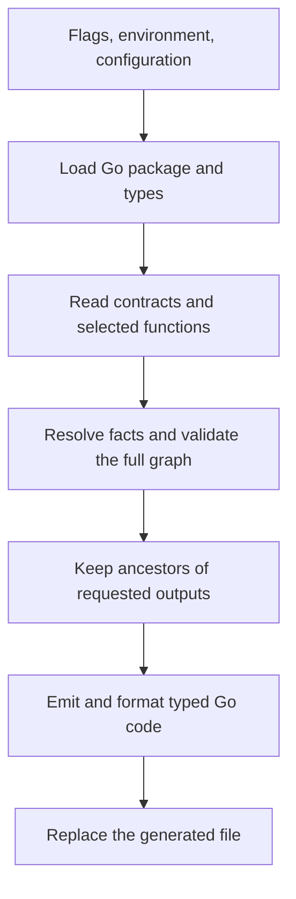

# Architecture

Infergo separates graph compilation from evaluation. The generator understands
Go types and fact names. The runtime understands rule IDs and dependencies. The
generated Go file connects the two.

## Repository map

| Location | Responsibility |
| --- | --- |
| [plan.go](../plan.go) | Public runtime types, graph validation, and scheduling. |
| [cmd/infergen/main.go](../cmd/infergen/main.go) | Cobra CLI, Viper configuration, and output replacement. |
| [internal/generate/generate.go](../internal/generate/generate.go) | Package loading, fact/type validation, pruning, and Go emission. |
| [ruleset/bonus/facts.go](../ruleset/bonus/facts.go) | Example contracts and generation directive. |
| [ruleset/bonus/bonus.go](../ruleset/bonus/bonus.go) | Example rules and arithmetic helpers. |
| [ruleset/bonus/zz_infergo_gen.go](../ruleset/bonus/zz_infergo_gen.go) | Committed generated example evaluator. |

The runtime imports only standard-library packages. Generator dependencies stay
in the CLI and internal compiler. Applications importing a generated ruleset do
not execute the compiler or load source files at runtime.

## Compilation pipeline

The compiler first checks file paths and reads a rule file's package clause. It
loads the package with `go/packages`, replacing the configured output through
an overlay. That overlay contains only a package clause, so stale generated
references do not break loading.

The compiler maps input fields to external facts, collects exported top-level
functions from selected files, and records each ordinary result as a producer.
It then resolves every input and requested output by exact name and Go type
identity. A rule's dependency list contains each producer rule once.

Cycle detection walks the entire selected graph and reports a rule path when it
finds a cycle. Only after validation does the compiler walk backward from the
requested outputs to retain required rules. This order explains why an invalid
unrequested branch still fails generation.

The emitter assigns compact rule IDs, selects import aliases that avoid package
names, and writes direct function calls. Sorting file paths and import paths
keeps output stable. `go/format` formats the result, and the CLI writes it through
a temporary file before replacing the destination.

## Generated evaluator

At package initialization, generated code calls `infergo.NewPlan` with constant
rule descriptors. It panics if that graph is invalid. Under normal generation,
the compiler has already checked the graph, so this protects against an invalid
generated descriptor set.

Each `Evaluate` call creates a local struct containing typed fields for derived
facts from retained rules. External facts are read directly from the input
struct. A callback switches on the rule ID, calls the corresponding Go function,
checks its trailing error, and stores results only after success.

When `Run` succeeds, the evaluator assembles the output contract from input or
derived facts. When it fails, the evaluator returns a zero output struct. It
does not expose intermediate storage.

The code uses neither a runtime fact map nor reflection. Fact names and types
have already become Go field accesses and function arguments by this point.

## Scheduler

`NewPlan` stores rule names, each rule's dependents, and initial dependency
counts. It deduplicates dependencies and builds a topological order. Failure
to include every rule in that order indicates a cycle.

Sequential `Run` calls walk that saved order and invoke callbacks directly.
Parallel calls copy the dependency counts and start a bounded worker pool for
that evaluation. A coordinator owns the ready queue and dispatch count. Workers
receive rule IDs and report completion through channels.

On success, the coordinator decrements dependency counts for that rule's
dependents. A count reaching zero makes a dependent ready. Worker completion,
coordinator receipt, and subsequent dispatch synchronize fact writes with reads
by dependent rules. Immutability keeps concurrent readers from racing with
mutations outside that sequence.

The completion channel has capacity for every worker. After an error or
cancellation, workers can report their final completion even though the
coordinator has stopped receiving. Cleanup cancels the execution context, closes
the job channel, and waits for the worker pool.

These details explain both the concurrency bound and the requirement that rules
honor cancellation. There is no mechanism to forcibly interrupt an arbitrary Go
function. The [runtime reference](runtime.md) describes the public guarantees.

## Boundaries

The compiler validates declarations, types, and graph structure. It does not
prove purity, infer dependencies hidden in function bodies, validate domain
values, or recover from a rule's panic.

The runtime evaluates a fixed graph once for each call. It has no fact mutation
API, persistence, event stream, retry policy, incremental cache, or dynamic
branch selection. Separate ruleset packages can express different fixed output
contracts, while application code owns request handling and external effects.

See the [development guide](../CONTRIBUTING.md) for tests covering these
boundaries and the workflow for changing generated code.
