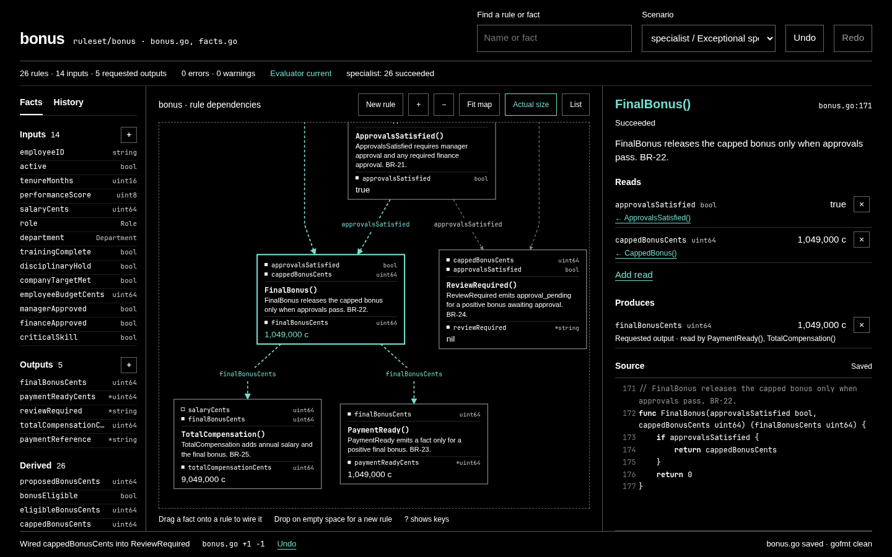
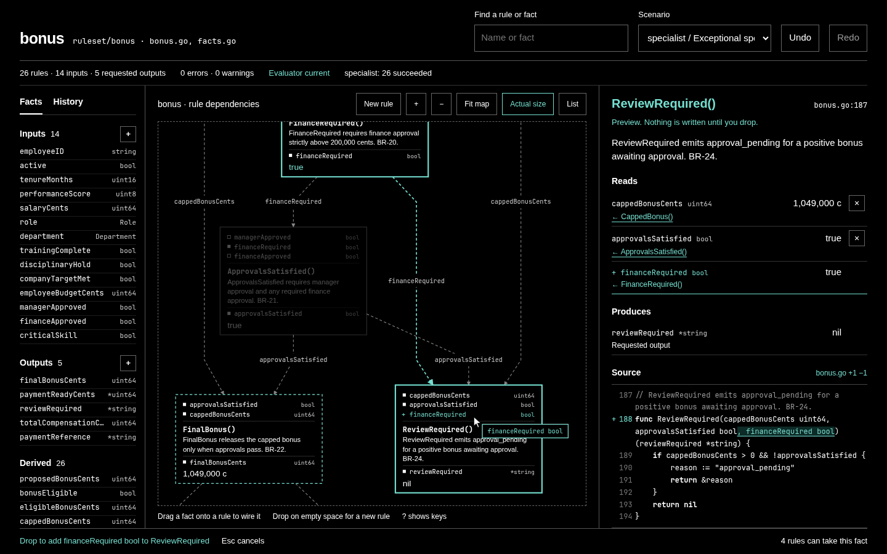
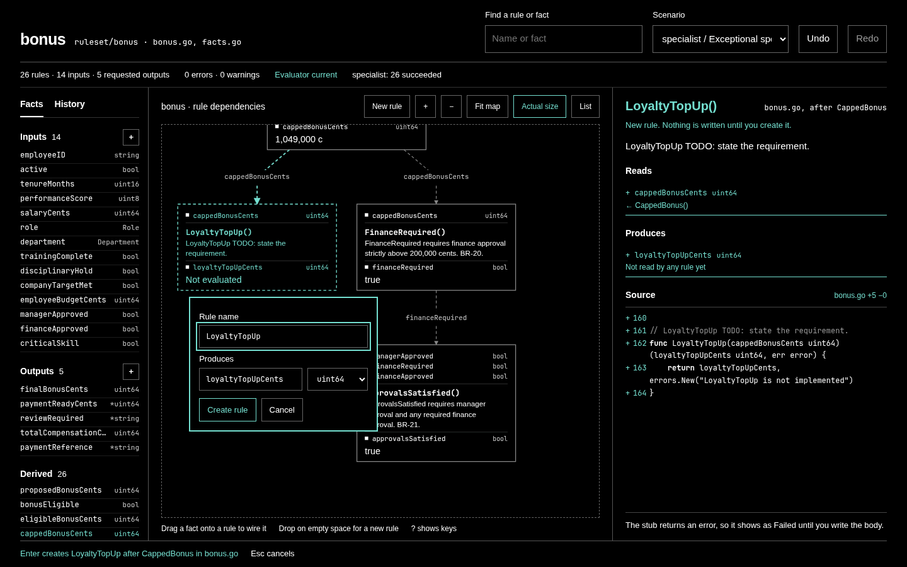
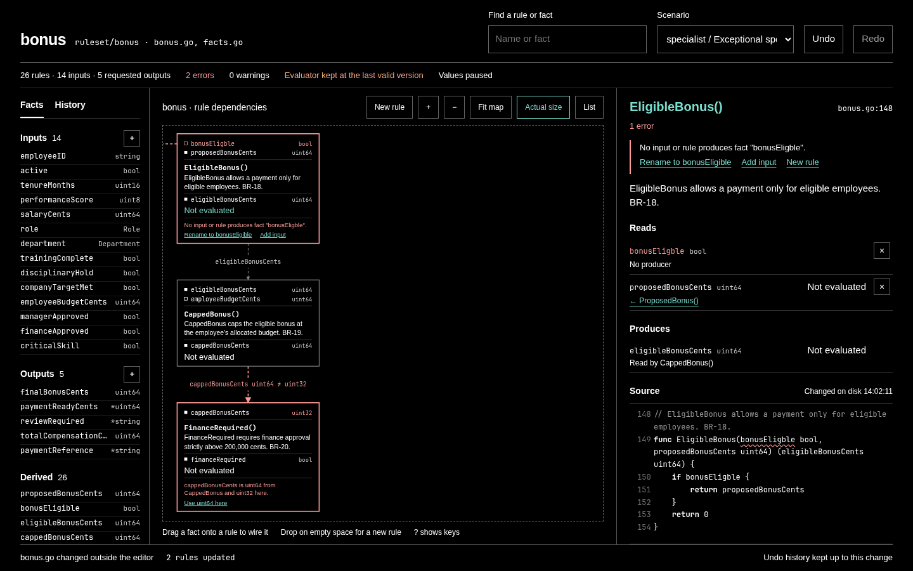
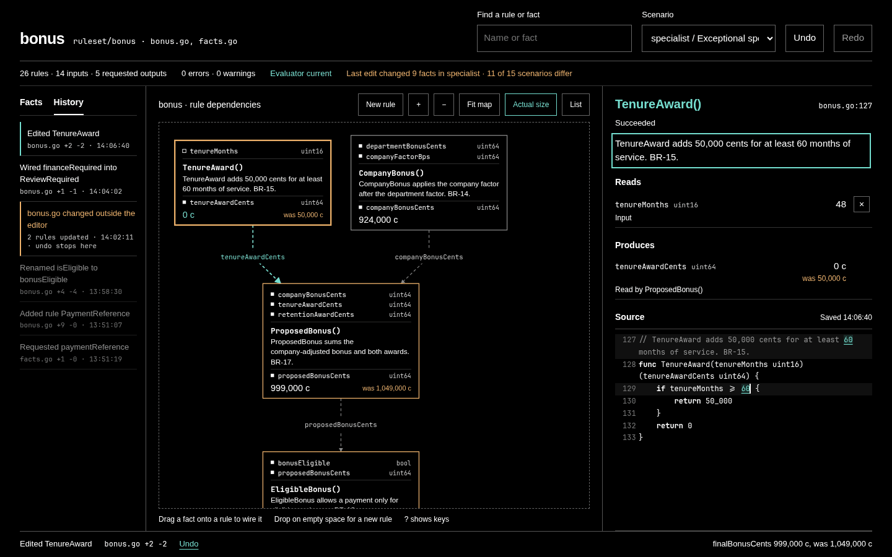
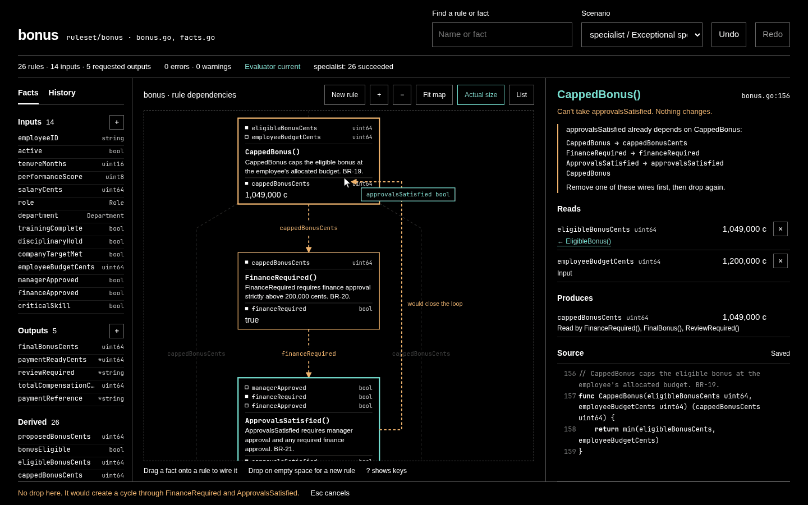
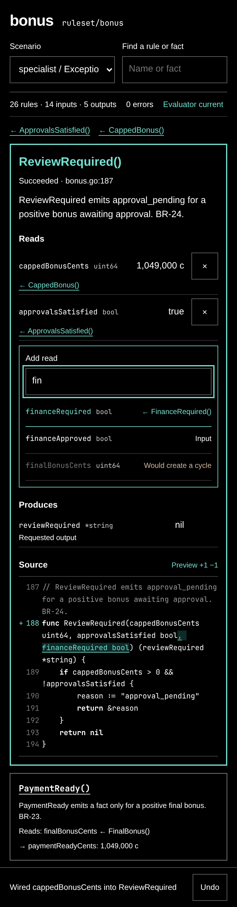
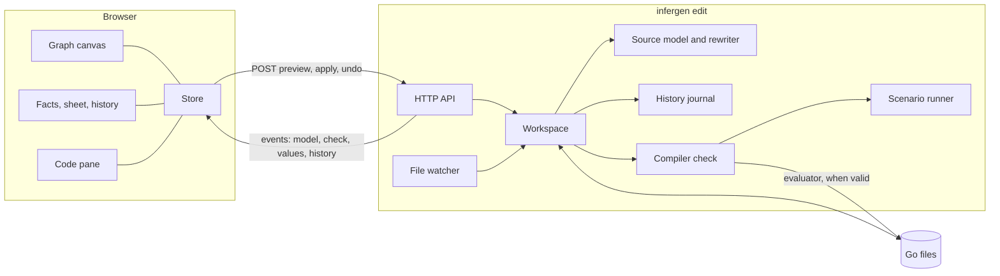

# GUI rule editor

Status: proposal, 23 November 2026. Nothing described here is built. A separate
effort will build a prototype from this document, so the last third is a work
plan with file ownership and acceptance criteria.

Claims are labelled measured, inferred, or guess. Measurements were taken on one
machine with 8 cores and Go 1.27.3, against `ruleset/bonus` (26 rules).

## Summary

`infergen edit` starts a server on localhost and opens a page that shows the
rule graph beside the Go source. You drag a fact onto a rule and the rule gains
a typed parameter in the `.go` file. You type a parameter in the code and the
graph gains a wire. The offline `ExportHTML` page and `infergen view` stay
read-only and unchanged.

The decisions that shape everything else:

- The Go files are the only stored state. The editor keeps no layout file, no
  metadata, and no model of its own on disk.
- Every gesture is a named operation, such as `add_read`. The server turns it
  into a byte-range edit of one or more `.go` files. It never reprints a file,
  so comments and untouched code stay byte-identical.
- The primary user is the Go developer who owns the ruleset. Domain experts can
  read, rewire, rename, and reword without writing Go. Function bodies stay Go.
- Feedback has two speeds. The graph redraws from a parse of the files, which
  takes about 1 ms (measured). The compiler's verdict follows about 265 ms
  later (measured) and lands on the graph as diagnostics with one-click fixes.
- A held fact shows its diff before you let go. While you aim at a rule, the
  code pane already shows the parameter it would gain.
- Two new dependencies: CodeMirror 6 for the code pane and fsnotify as a direct
  dependency for file watching. No UI framework.



## Where this departs from the brief

The brief's frame holds: Go files as the source of truth, a local server, a
graph beside a code editor, and sync in both directions. Four points differ.

- The brief has the compiler rerun after each edit and drive the graph. Here
  the graph is drawn from a parse, and the compiler only adds diagnostics. The
  compiler returns no model while a body fails to type-check, so a graph that
  depended on it would freeze in the middle of most edits.
- The embedded editor shows one declaration, not a file. Reasons are under
  [Code to graph](#code-to-graph).
- The editor regenerates the evaluator whenever the ruleset is valid. The
  brief did not ask for this. Without it the package stops compiling in the
  IDE after the first rename.
- Live values are a stretch goal and start switched off, because running
  scenarios runs the user's rules.

## Who it is for

The editor is for Go developers first. Three facts decide this.

`infergen edit` needs a source checkout and a Go toolchain, and the person who
has both is a developer. A rule body is arbitrary Go, so a friendlier body
editor would be a second language. It would either express less than Go, or it
would fail to load Go that someone wrote by hand, and then the files would stop
being the source of truth. And the parts of a ruleset that a domain expert
cares about are mostly not body logic. They are which facts exist, what feeds
what, how each requirement is worded, and what the numbers come out as.

So the editor has three levels, and each one works without the next.

| Level | What you can do | Go needed |
| --- | --- | --- |
| Read and trace | Follow the graph, read requirements, compare scenarios | None |
| Shape and word | Wire and unwire facts, rename, add rules and inputs, request outputs, rewrite requirement text | None. The editor writes the Go |
| Logic | Edit function bodies in the code pane | Yes |

A domain expert works at the first two levels on a developer's machine or in a
pairing session, and a developer reviews the diff. The prototype builds the
first two levels fully and gives the third a plain code editor.

I am not proposing a friendlier body editor now. The cheapest later bridge is a
set of lenses, described under [Later ideas](#later-ideas).

## Interaction model

The page uses six words: rule, fact, reads, produces, input, and output. A wire
is a read of a fact that another rule produces. A wire has no source text of its
own. It exists because one rule has a parameter with the same name as another
rule's result. Wiring is therefore parameter-list editing, and that is why a
drag can map to a one-line diff.

### Pick up, aim, drop

Wiring is one state machine with three ways in. Drag and drop is the fastest,
and it is never the only one.

| Input | Pick up | Aim | Drop | Cancel |
| --- | --- | --- | --- | --- |
| Pointer drag | Press on a fact | Move over a rule | Release | Release on nothing, or Esc |
| Click or tap | Click a fact | Hover or tap a rule | Click it | Esc, or click the fact again |
| Keyboard | `W` on a focused fact | Arrow keys step through rules that can take it | Enter | Esc |

You can pick a fact up from a produces row in a node, an edge label, a row in
the Facts column, or a row in the rule sheet. Input facts live in the Facts
column, so wiring an input works the same way as wiring a derived fact.

While a fact is held, rules that can take it get a dashed teal outline and the
rest dim. A rule cannot take a fact that it already reads or produces, or whose
producer depends on that rule. The page decides this from the model it already
has, so the answer is instant and visible before the drop.



### The preview is the diff

While you aim, the code pane shows the target's declaration with the pending
edit marked, and the rule sheet shows the pending read. Nothing is written.
Dropping applies exactly what was shown. The same preview appears when a
keyboard user steps onto a rule, when the pointer rests on a remove button, and
when a fix link has focus.

The server computes the preview with the same code that applies it, so the
two cannot differ. Parsing `bonus.go`, splicing a parameter in, and formatting
the result took 1 ms (measured), so a preview per hover is affordable.

### Gestures and their source edits

| Gesture | Operation | Edit to the Go source |
| --- | --- | --- |
| Drop a fact on a rule | `add_read` | Appends `name type` to that function's parameter list |
| Select a wire or a read and press Delete, or press its remove button | `remove_read` | Removes that parameter. The body is left alone |
| Drop a fact on empty canvas, or choose New rule | `add_rule` | Inserts a documented stub function after the dropped fact's producer, or at the end of the first rule file |
| Delete a rule | `delete_rule` | Removes its doc comment and declaration |
| Rename a fact with `F2` | `rename_fact` | Renames the result in its producer, the parameter in every reader, each use inside those bodies, and the `fact` tag in both contracts |
| Rename a rule with `F2` | `rename_rule` | Renames the function, the first word of its doc comment, and references in the package and its tests |
| Edit the requirement text in place | `set_requirement` | Rewrites the doc comment, wrapped at 80 columns |
| Add or remove a result in the sheet | `add_produce`, `remove_produce` | Edits the result list |
| Accept a type fix | `set_type` | Replaces one type expression in one declaration |
| Add or remove an input in the Facts column | `add_input`, `remove_input` | Adds or removes a field with a `fact` tag in the input struct |
| Drop a fact on Outputs, or remove it there | `set_requested` | Adds or removes a field in the output struct |
| Type in the code pane | `replace_source` | Replaces that declaration's bytes with the buffer, if the file still parses |

A new rule is created where you drop. The form asks for a rule name and derives
the result name from it. The stub compiles and fails loudly:

```go
// LoyaltyTopUp TODO: state the requirement.
func LoyaltyTopUp(cappedBonusCents uint64) (loyaltyTopUpCents uint64, err error) {
	return loyaltyTopUpCents, errors.New("LoyaltyTopUp is not implemented")
}
```

The stub returns an error on purpose. A stub that returned zero would look like
a real result in the values. With an error, the rule shows as Failed and its
dependents as Not run, which matches what happened. A panic would abort the
whole scenario and hide every other value.



### Code to graph

The code pane shows one declaration, the selected rule with its doc comment. It
is a real editor with Go highlighting, not a text area.

- Typing sends `replace_source` after 300 ms without a keystroke. The server
  splices the buffer into the current file. If the file parses, the server
  writes it and the graph updates. If it does not, nothing is written, the pane
  names the line, and the graph keeps the last version that parsed.
- gofmt runs when focus leaves the pane, on `Ctrl+S`, and before any graph
  gesture. It does not run while you type, because reformatting under the
  cursor moves it.
- An edit made in another editor arrives through the file watcher and updates
  the graph and the pane the same way.
- Missing and unused imports are fixed on save with `golang.org/x/tools/imports`.

I chose one declaration over the whole file for three reasons. An IDE edit to a
different function merges without conflict, because the server replaces only
that declaration's bytes. The pane stays readable at 436 px. And this user
always has an IDE for helpers and types. The cost is that you cannot add a
helper or a type in the browser. The sheet shows the file and line so the IDE is
one click away.

### One fact, lit everywhere

Hover or focus a fact anywhere and every occurrence turns teal: its row in the
Facts column, its produces row, each reads row, each wire, and each use of the
identifier in the code pane. A fact name is the only thing the graph and the
code share, so highlighting it in both shows which line a wire comes from.

### Diagnostics carry their repair

The compiler already reports every problem with a position, and for a missing
fact it already computes a suggestion. The editor draws each finding on the
thing it is about and offers the edits that would clear it.

| Compiler finding | Drawn on | Fixes offered |
| --- | --- | --- |
| No input or rule produces a fact | The read, with a dangling stub in place of a wire | Rename to the suggested fact. Add an input. Create a rule that produces it |
| A reader's type differs from the producer's | The wire and the reader's row, with both types | Use the producer's type here |
| A fact has two producers | Both produces rows | Rename one |
| Rule dependency cycle | Every wire on the cycle | Remove this wire, offered on each |
| Unsupported signature | The rule | Name the result, where that is mechanical |
| Go type error | The rule that contains the position, and the line in the code pane | None |
| Rule not needed by any output | The rule, dimmed | Request its output. Delete the rule |
| Input not used | Its row in the Facts column | Remove the input |

A fix is an ordinary operation. It previews, it lands in history, and it
undoes, exactly like a drag.



### Live values and what an edit changed

This part is a stretch goal for the prototype.

With saved scenarios, each node shows its values for the selected scenario, as
the viewer does. After an edit the server rebuilds and reruns the scenarios,
and the page compares the new values with the ones before the edit. A fact
whose value moved shows the old value beside the new one. The summary line
counts scenarios whose requested outputs differ.

This turns saved scenarios into a regression check that runs while you edit.
The mockup shows a real case. Raising the tenure threshold in `TenureAward`
from 36 to 60 months moves `finalBonusCents` in the specialist scenario from
1,049,000 to 999,000 cents (measured by running the changed rule).



### Undo, redo, and history

Every write the server makes becomes a history entry with a sentence, the files
it touched, and line counts. The newest entry stays in the status line with an
Undo button, so each gesture leaves a receipt that says what it did to the code.

- An entry stores the bytes of each touched file before and after. `bonus.go`
  is 7.6 kB, so a thousand entries cost a few megabytes of memory.
- Undo writes the before bytes back, but only if the file on disk still matches
  the entry's after bytes.
- A change from outside breaks that match. It gets its own entry, and entries
  older than it for that file can no longer be undone here. The entry says so.
  The IDE and git still hold that history.
- Keystrokes in the code pane merge into one entry per rule until another
  operation happens or two seconds pass.
- `Ctrl+Z` follows focus. In the code pane it steps through that buffer
  character by character. Anywhere else it undoes the newest history entry.
  When a history undo changes the declaration under the pane, the pane reloads
  it and clears its own buffer history, so the two stacks cannot disagree.
- History lives in memory and ends with the server.

### Failure behaviour

| Situation | What happens |
| --- | --- |
| A drop would create a cycle | The rule never becomes a target. Aiming at it shows the cycle as a path on the graph and as a list in the sheet. Nothing is written |
| Code typed by hand creates a cycle | The file is written, because it is valid Go. The wires on the cycle turn red and each offers Remove this wire. The evaluator on disk is kept |
| A drag cannot cause a type mismatch | The new parameter copies the fact's type from its producer |
| Code typed by hand causes a type mismatch | The wire and the reader's row turn red and show both types. One fix aligns the reader with the producer |
| A removed read is still used in the body | The parameter is removed, as asked. The compiler reports the undefined name on the rule and in the code pane. The status line says how many uses remain and offers Undo |
| A rename would shadow or collide | The server refuses before writing and names the function and identifier, for example a fact named `sum` in a rule that calls `sum()` |
| The buffer in the code pane does not parse | Nothing is written. The pane shows the line. The graph keeps the last version that parsed |
| A file on disk does not parse | The graph keeps that file's last parsed version and marks it stale. Graph edits to that file are refused with the position of the error. Edits to other files still work |
| A file does not parse when the editor starts | Rules up to the error are shown and the rest are reported as unknown. In a spike, breaking the signature of the 20th rule made `go/parser` drop all eight functions after it, six of them rules (measured), so the editor does not pretend to know them |
| A function has a shape the model does not support | It is drawn as a rule with the compiler's message. Its body stays editable. Structural gestures on the unsupported part are off and say why |
| The pane's declaration changed on disk while the pane has unsaved text | The save is refused. The pane offers to load the version on disk or keep the buffer. Loading is one undo step in the buffer |
| The compiler cannot load the package at all | The graph still draws from the parse. The summary shows the load error. Values pause |
| A rule fails or panics during a scenario run | A failure shows on the rule as in the viewer. A panic is reported for that scenario with its message, and its values are unavailable |

The editor never refuses a valid edit because the ruleset would be invalid
afterwards, with one exception. It refuses a drop that it already knows closes
a cycle, because no useful work passes through that state.

### Keyboard and accessibility

- Every action has a route that needs no drag: the pick up, aim, drop table
  above, the remove buttons, and the Add read picker in the sheet. WCAG 2.2
  asks for this under Dragging Movements (cited from memory, not read in this
  session).
- The graph has one tab stop. Arrow keys move between rules along wires. Up
  goes to a producer, Down to a reader, Left and Right to siblings.
- Keys: `Enter` opens the code pane, `A` adds a read, `W` picks up a fact,
  `F2` renames, `Delete` removes, `N` creates a rule, `Ctrl+Z` and
  `Ctrl+Shift+Z` undo and redo, `?` lists the keys.
- The Add read picker is a combobox. Facts that cannot be wired stay in the
  list, disabled, with the reason beside them.
- A list view presents the same rules as text, in dependency order. It is the
  layout below 1100 px and a toggle above it. It reaches every operation
  through the sheet, so a screen reader user never needs the canvas.
- Each node's accessible name says what it reads, what it produces, and how
  many problems it has. A live region announces receipts, refusals, and changes
  in the error count.
- State is never carried by colour alone. Errors have text, pending edits carry
  a plus sign, and refused targets say why.
- With reduced motion set, the graph moves to a new layout without a transition.

## Layout and visual language

The editor keeps the viewer's look: true black, white text, square 1 px
borders, dashed wires with labels and arrowheads, teal `#74dfd0` for the
selection, amber `#f0b36c` for warnings, and `#ff9999` for errors. Identifiers
are monospace and prose is the system sans. Controls keep the viewer's 44 px
height.

The page has three columns above 1100 px.

| Column | Width | Holds |
| --- | --- | --- |
| Facts | 204 px | Inputs, Outputs, and Derived facts, each row a drag source. A History tab replaces the lists |
| Graph | The rest | The canvas, with New rule, zoom, fit, and the list toggle |
| Rule | 436 px | The rule sheet (name, requirement, reads, produces) and the code pane |

A summary line under the header carries counts, errors, and the evaluator's
state. A status line at the bottom carries the newest receipt or the pending
gesture. The Facts and Rule columns collapse with `[` and `]`.

Three rules govern the visual design.

Colour means state and nothing else. Teal marks what is selected or pending,
amber marks what was refused or changed, and red marks errors. The code pane
highlights with weight and grey alone, so a teal insertion or a red underline
cannot be mistaken for syntax colouring.

Pending things share one treatment. A pending read in a node, a pending row in
the sheet, a pending wire, and an inserted span in the code are all teal with a
plus sign. A dashed teal outline always means "this would happen".

Every line in a node is data. The viewer's constant line
`[Rule · Go function]` is replaced by the rule's reads, each with a type. A
filled square marks a read that another rule produces and a hollow square
marks an input. Produces rows sit at the bottom, above the value.

The graph has no continuous animation. A layout change moves nodes once, over
150 ms, and the node under the pointer or the selection keeps its place on
screen so the graph does not jump away from you. Nothing pulses, shimmers, or
spins. A running check is a word in the summary line.



Below 1100 px the canvas is replaced by the list view, as in the viewer. The
selected rule expands into the same sheet and code pane. Nothing scrolls
sideways: long identifiers wrap, the code pane soft-wraps, and the status line
stays inside the viewport. The mockup was rendered at 390 px with no horizontal
overflow (measured).



The reference component in another project, a graph canvas beside a Monaco
editor, contributed three ideas: the side-by-side arrangement, a validation
panel, and a drawer of pending changes that became the history list here. Its
grid layout, unlabelled edges, and hidden arrowheads are what this design
avoids. That project is AGPL-3.0, and no code was taken from it.

## Architecture



### The command

`infergen edit` takes the same flags, environment variables, and config file as
generation, plus `--port`, `--open`, and `--scenarios`. It binds `127.0.0.1` on
a free port, prints the URL, and serves until interrupted. The editor's assets
are embedded in `cmd/infergen` through an internal package. The runtime package
that applications import gains nothing.

### What happens to one edit

1. The page sends `POST /api/apply` with an operation.
2. The workspace takes its lock and rereads the target files if their size or
   modification time changed, so an edit never applies to stale bytes.
3. The rewriter parses the files, computes byte-range edits, applies them, and
   formats the result.
4. The workspace checks the result: it parses, it is gofmt output, and, for a
   file that was already formatted, every byte outside the touched
   declarations is unchanged.
5. The workspace writes each file through a temporary file and a rename,
   records a history entry, and bumps the revision.
6. The server parses the new files into a model and pushes it. The graph
   redraws here, a few milliseconds after the gesture.
7. The server runs the compiler in the background. On success it writes the
   evaluator if it changed. It pushes the diagnostics either way.
8. If live values are on and the check passed, the server rebuilds and runs
   the scenarios and pushes the snapshots.

Results that belong to an older revision are dropped. One check runs at a time
and the newest revision waits behind it.

### Source rewriting

The rewriter works on bytes. It parses with `go/parser`, reads the byte
offsets of the nodes it needs, builds a list of replacements, applies them to
the original bytes, and passes the result through `go/format`. Go's own
analysis tooling expresses suggested fixes the same way, as byte-range text
edits (inferred, not checked in this session).

In a file that was already formatted, everything the rewriter did not touch
stays byte-identical, so comment preservation is not something the code has to
get right case by case. In the spike, adding a parameter to `ReviewRequired`
changed one line of 232 and kept all 33 comments (measured).

I rejected two alternatives. Printing a modified `go/ast` tree with
`go/printer` can move free-floating comments when nodes are added or removed
(inferred from experience, not tested here). A decorated syntax tree library
would handle that, but it is a new dependency for a problem that splicing does
not have.

Parameter and result lists need four rules, each covered by a table test:

- Append after the last field with `, name type`. If the list is written one
  field per line with a trailing comma, add a line in that style.
- Remove a field together with one adjacent comma.
- When a field declares several names, as in `a, b int`, remove or add only
  the name.
- If a comment sits inside the list where the edit would land, refuse and
  point at the code pane.

Most operations need only the parsed file. Two need type information, and they
load the package with `go/packages` as the compiler does.

`rename_fact` collects the parameter and result objects named for the fact,
then replaces every identifier that `types.Info` resolves to them. Before
writing it checks each affected function for two conflicts: a declaration of
the new name anywhere inside it, and a use of the new name that currently
resolves to something outside it. Either one refuses the rename. This is
stricter than necessary and never silently changes meaning.

`rename_rule` renames the function and its references in the package and its
tests. Callers in other packages are not updated, and the receipt says so.

Formatting follows one rule. A file the editor writes is gofmt output. If the
file was not formatted before, the first receipt for it says that it also
formatted the file.

A new contract field takes the fact's name with its first letter in upper
case, and always gets an explicit `fact` tag. A new parameter copies the type
text from the fact's producer, which is valid because both sit in one package.

### Two speeds of analysis

| Pass | Built on | Gives | Time on bonus |
| --- | --- | --- | --- |
| Parse | `go/parser`, one file at a time | Rules, reads, produces, contracts, doc comments, byte ranges | About 1 ms (measured, with splice and format) |
| Check | `internal/generate`, which loads and type-checks the package | Diagnostics, pruned rules, evaluator source | 260 to 280 ms warm, 846 ms on the first run (measured) |

The graph is drawn from the parse. There are two reasons, and the second is the
stronger one. The parse is fast enough to redraw on every keystroke pause. And
the compiler returns no model at all when the package has a Go type error,
which is the normal state halfway through an edit. A graph that froze whenever
a body failed to compile would be useless as an editor.

The parse decides what a rule is from syntax alone: an exported top-level
function in a selected file, with a first parameter spelled `context.Context`
and a last result spelled `error` set aside. The compiler decides the same
thing from types. The two can drift, so a test asserts that they agree on
rules and facts for every fixture that compiles.

Contracts declared in another package cannot be read from syntax. The editor
shows them from the last successful check and marks them read-only.

### Sync with disk

The watcher uses fsnotify on the ruleset directory. Many editors save by
writing a new file and renaming it over the old one, and a watch on a single
file can miss that (inferred). Events are collected for
50 ms. For each changed file in the workspace, the server hashes the content
and compares it with the last bytes it read or wrote.

- Same hash: its own write, or a save with no change. Ignored.
- Different hash: an outside edit. The server parses it, bumps the revision,
  adds a history entry, and pushes the model.

The generated evaluator is ignored by path. Applying an operation rereads its
target files first, so a watcher event that has not arrived yet cannot cause a
lost update.

Operations are resolved against the current file, not against the text the
page last saw. A drag that arrives after an IDE save still does the right
thing, because "add this read to this rule" is looked up afresh. If the rule is
gone, the operation is refused and the page already has the new model.

`replace_source` is the one operation that carries text. It also carries the
hash of the declaration the buffer started from. If the declaration on disk no
longer has that hash, the server refuses and the pane asks which version to
keep.

One case cannot be solved from this side. If the IDE holds unsaved changes to a
file and the editor writes that file, the IDE will warn on its next save. Small
writes scoped to one declaration keep that rare. The user guide should say to
save in the IDE before editing in the graph.

### Protocol

Commands are `POST` requests with JSON bodies. Updates flow back on one
`text/event-stream` response. This needs no WebSocket library, and the stream
only ever flows one way. The Go structs in `internal/edit/protocol` and the
types in `protocol.ts` mirror the definitions below, and a test on each side
checks them against shared fixture files.

| Request | Body | Reply |
| --- | --- | --- |
| `GET /api/model` | | `Model` |
| `GET /api/events` | | Stream of `model`, `check`, `values`, and `history` events |
| `POST /api/preview` | `{op}` | `{changes: Change[]}` or a `Refusal`. Writes nothing |
| `POST /api/apply` | `{op}` | `{revision, receipt}` or a `Refusal` |
| `POST /api/undo`, `POST /api/redo` | | `{revision, receipt}` or a `Refusal` |
| `POST /api/values` | `{enabled}` | Turns scenario runs on or off |

```ts
type Model = {
  revision: number;        // bumped on every accepted change, from any source
  package: string;
  files: SourceFile[];
  inputs: Contract;
  outputs: Contract;
  rules: Rule[];           // in source order
};
type SourceFile = { path: string; hash: string; state: 'ok' | 'syntax_error'; problem?: Position & { message: string } };
type Position = { file: string; line: number; column: number };
type Contract = { type: string; file: string; editable: boolean; fields: { field: string; fact: string; type: string; line: number }[] };
type Fact = { name: string; type: string };
type Rule = {
  id: string;              // function name
  file: string;
  line: number;
  requirement: string;     // doc comment text
  source: string;          // doc comment and declaration, as on disk
  sourceHash: string;      // base for replace_source
  reads: Fact[];           // ordinary parameters, in order
  produces: Fact[];        // named ordinary results, in order
  usesContext: boolean;
  returnsError: boolean;
  stub: boolean;
  unsupported?: string;    // why structural edits are off for this rule
};

type Op =
  | { op: 'add_read'; rule: string; fact: string; type: string }
  | { op: 'remove_read'; rule: string; fact: string }
  | { op: 'add_rule'; name: string; reads: Fact[]; produces: Fact[]; after?: string }
  | { op: 'delete_rule'; rule: string }
  | { op: 'rename_rule'; rule: string; to: string }
  | { op: 'rename_fact'; fact: string; to: string }
  | { op: 'set_requirement'; rule: string; text: string }
  | { op: 'add_produce'; rule: string; fact: string; type: string }
  | { op: 'remove_produce'; rule: string; fact: string }
  | { op: 'set_type'; rule: string; fact: string; type: string }
  | { op: 'add_input'; fact: string; type: string }
  | { op: 'remove_input'; fact: string }
  | { op: 'set_requested'; fact: string; requested: boolean }
  | { op: 'replace_source'; rule: string; text: string; base: string };

type Change = { file: string; rule?: string; before: string; after: string };  // one per touched declaration
type Refusal = {
  reason: 'cycle' | 'exists' | 'not_found' | 'shadow' | 'unsupported' | 'syntax_error' | 'stale_base' | 'conflict';
  message: string;
  related?: string[];      // rule names, for a cycle
};
type Receipt = { id: number; label: string; source: 'editor' | 'disk'; files: { path: string; added: number; removed: number }[]; time: string };
type History = { entries: Receipt[]; cursor: number };  // entries before cursor can be undone

type Check = {
  revision: number;
  ok: boolean;
  diagnostics: Diagnostic[];
  pruned: string[];        // rules no output needs
  evaluator: 'current' | 'updated' | 'kept';
};
type Diagnostic = Partial<Position> & {
  severity: 'error' | 'warning';
  kind: 'missing_producer' | 'type_mismatch' | 'duplicate_producer' | 'cycle' | 'signature'
      | 'contract' | 'reserved' | 'go' | 'unused_rule' | 'unused_input';
  message: string;
  rule?: string;
  fact?: string;
  related?: string[];      // cycle: rules in order. duplicate_producer: the other rule
  fixes: { label: string; op: Op }[];
};
type Values = { revision: number; cases: Snapshot[]; error?: string };  // Snapshot as in viewer.ts
```

The model is sent whole each time. For bonus it is a few kilobytes, and a full
replacement means the page never patches state.

### Diagnostics on the graph

Today the compiler collects positioned notes and joins them into one error.
The editor needs them as data, so `internal/generate` gains a report:

```go
type Diagnostic struct {
	Severity   string // "error" or "warning"
	Kind       string
	Position   token.Position
	Message    string
	Rule, Fact string
	Related    []string
	Suggestion string // the "did you mean" fact, if any
}

// Check compiles the ruleset and returns every diagnostic. Result is nil when
// an error is present. The error is for a ruleset that cannot be loaded at all.
func Check(config Config) (Report, error)

type Report struct {
	Diagnostics []Diagnostic
	Result      *Result
}
```

`Generate` keeps its signature and its output, and formats the same
diagnostics into the error it returns today. Go type errors come through as
kind `go` with their positions. The server maps a position to a rule through
the parse model's byte ranges, and it attaches fixes by kind. Fix construction
lives in the server, so the compiler stays free of editor concerns.

### The evaluator on disk

When a check passes, the server writes the generated evaluator if its content
changed, with the write-if-different behaviour of the CLI today. When a check
fails, the last valid evaluator stays, as the generator already guarantees. The
summary line says which of the two happened. Without this, a rename in the
graph would leave the package uncompilable for the IDE until someone ran
`go generate`.

### Scenario runner

Scenarios come from an exported function in the ruleset package, by default
`func Scenarios() []ViewerCase`. Go keeps them typed, so renaming an input
breaks a scenario at compile time and not silently. The offline export can call
the same function.

The runner writes a small `main` package that calls `EvaluateTrace` for each
case and prints the snapshots as JSON, in the shape the viewer already renders.
It builds that package with `go build -overlay`, so no file is added to the
user's tree, then runs the binary. `go help build` states that overlays do not
apply to binaries run through `go run`, which is why it builds first. In a
spike the first build took 366 ms, a rebuild after a body edit 474 ms, and the
run 3 ms (measured).

Running scenarios runs the user's rules, and a rule may do I/O. Live values are
therefore off until the user turns them on for the session.

### Security

A local server that writes source files needs more care than a static page.

- It binds `127.0.0.1` only.
- It rejects any request whose `Host` is not that address and port, which
  blocks DNS rebinding.
- Every state-changing route sits behind `http.CrossOriginProtection`, which
  the standard library has had since Go 1.25 (measured: it is listed in
  `api/go1.25.txt`). Another site's page cannot post to it.
- The printed URL carries a random session token that the page sends with each
  request. Another user on the same machine cannot drive the server.
- It writes only the configured rule files, the files that declare the two
  contracts, and the generated evaluator, all inside the ruleset directory. It
  refuses symbolic links, as `view` does.

## Technology choices

| Choice | Licence | Why | Cost |
| --- | --- | --- | --- |
| CodeMirror 6: `codemirror`, `@codemirror/lang-go`, `@codemirror/lint` | MIT, read from the `package.json` of these three and of the 15 packages they install | Decorations draw the diff preview and the fact highlight. Lint markers show diagnostics. It works with touch. It bundles into one file | 441 kB minified, 149 kB gzipped (measured with esbuild). The viewer bundle is 78 kB |
| fsnotify | BSD-3-Clause, read from its `LICENSE` | File watching. Already in `go.sum` through viper | Becomes a direct dependency |
| `golang.org/x/tools`: `go/packages`, `imports` | Already a dependency | Type information for renames, import fixing | None |
| `@dagrejs/dagre` | MIT, already used | Same layout as the viewer. It lays out a cyclic graph without failing (measured on a three-rule cycle), so invalid states can be drawn | Layout moves when the graph changes |
| Vanilla TypeScript, no framework | | Matches the viewer. Each region renders from one store | The sheet needs care around focus. See Risks |
| Server-sent events and `POST` | Standard library | No WebSocket dependency | None |
| The viewer's `navigation.ts` | Apache-2.0, in this repository | Pan and zoom, reused as is | None |

All of these are compatible with Apache-2.0. The build script must add the
CodeMirror licences to the bundle header, as it does for dagre today.

I considered and rejected three things from memory, without reading their
current terms in this session, so treat the reasons as inferred. Monaco is
several megabytes, needs web workers, and is weak on touch. A layout engine
with ports, such as elkjs, would attach wires to fact rows, but it is much
larger than dagre and its licence is weak copyleft. A WebSocket library is
unnecessary for a one-way stream.

The editor bundle is checked in next to its sources, as `viewer.js` is, so
`go install` works without Node. Expect about 0.6 MB (guess: CodeMirror plus
dagre plus the editor's own code).

## Risks

| Risk | Why it matters | Response |
| --- | --- | --- |
| Layout shifts after an edit | Dagre reflows the whole graph, and a graph that jumps is disorienting | Anchor the node under the pointer and move once. If the bonus graph still feels unstable, hold ranks fixed between edits. Needs testing with real use |
| Rename changes meaning | Shadowing can compile and still be wrong | Conservative conflict checks that refuse. A check runs after every rename |
| Two definitions of a rule | The parse and the compiler can disagree | An agreement test over all fixtures |
| The IDE has unsaved changes | The editor's write makes the IDE warn | Small writes, documented advice. Not solvable from this side |
| A file-writing server on localhost | Other pages or users could drive it | The five measures under Security |
| Scenario runs execute rules | A rule may have side effects | Off by default, explicit switch |
| UI complexity without a framework | Forms that redraw while focused lose the caret | One rule: a region never replaces the element that has focus. Revisit if the sheet outgrows it |
| Bundle size in the repository | Each rebuild adds to git history | Accept for the prototype. Revisit before a release |
| Rename and replace on Windows, and watcher differences across systems | Atomic replace and events behave differently | Linux and macOS for the prototype. Test Windows before release |
| Scope | The gesture list is long | The prototype has a cut line, below |

## Prototype scope

The prototype has to prove the round trip in both directions on the bonus
ruleset, and it has to prove that a wrong edit is cheap.

It must demonstrate:

1. `infergen edit` in a copy of `ruleset/bonus` opens the three-column page
   with all 26 rules.
2. Dragging a fact onto a rule shows the diff while aiming and writes one
   changed line on drop. The file stays gofmt clean and keeps every comment.
3. Removing a wire removes the parameter. A leftover use shows as an error on
   the rule and in the code.
4. A drop that would close a cycle is refused with the path shown.
5. Typing a parameter in the code pane adds the wire. Saving the file from
   another editor updates the graph within a quarter of a second.
6. Missing producer, type mismatch, cycle, and Go type errors each appear on
   the right element, and the first two can be fixed with one click.
7. Renaming a fact updates its producer, its readers, their bodies, and the
   contract tags.
8. Dropping a fact on empty canvas creates a stub rule. Deleting a rule works.
9. Editing requirement text rewrites the doc comment.
10. Undo and redo work for every gesture, and an outside edit appears in
    history.
11. Wiring, unwiring, renaming, and creating a rule all work from the keyboard.
12. At 320 px the page has no horizontal scroll and the sheet can wire and
    unwire.
13. The evaluator on disk is regenerated whenever the ruleset is valid.

Stretch, built only if the items above are done: live values, and the
before-and-after comparison.

Cut from the prototype:

- Editing whole files, helpers, or types in the browser.
- A type-change refactor beyond the single-declaration fix.
- Arranging nodes by hand.
- Editing scenarios in forms.
- Code completion.
- Rulesets spread over several packages, and contracts declared in another
  package, which are shown read-only.
- Updating callers in other packages when a rule is renamed.
- Windows.
- Changing the offline viewer. It is not touched.

## Implementation plan

### Layout of the code

```text
cmd/infergen/edit.go             the edit command
internal/generate/               gains Check and Diagnostic
internal/edit/protocol/          wire types as Go structs
internal/edit/source/            parse model and rewriter. No I/O
internal/edit/workspace/         file state, writes, watcher, history
internal/edit/server/            HTTP, event stream, check scheduling, embedded assets
internal/edit/runner/            scenario build and run
internal/edit/web/               editor.html, editor.js (built), build.mjs, fixtures/
internal/edit/web/src/           protocol.ts api.ts store.ts main.ts
internal/edit/web/src/graph/     canvas, layout, gestures
internal/edit/web/src/sheet/     rule sheet
internal/edit/web/src/facts/     facts column
internal/edit/web/src/history/   history list and status line
internal/edit/web/src/list/      list view for narrow screens
internal/edit/web/src/code/      code pane
tests/ui/editor.spec.cjs         browser tests
docs/editor.md                   user guide
```

### Interfaces between workstreams

Three contracts let the workstreams move in parallel.

The wire protocol is the section above. Fixture files in
`internal/edit/web/fixtures/` hold a bonus model, a check with one diagnostic
of each kind, and a values event. A Go test decodes and re-encodes them, and
the TypeScript build type-checks them.

The Go packages meet at these signatures:

```go
// internal/edit/source. Paths are relative to the ruleset directory.
type Files map[string][]byte
type Config struct {
	RuleFiles       []string
	Inputs, Outputs string
}

func Parse(files Files, config Config) protocol.Model
func Apply(files Files, config Config, op protocol.Op) (Result, error)
func ApplyTyped(pkg *packages.Package, files Files, config Config, op protocol.Op) (Result, error)

type Result struct {
	Files   Files             // new content of each touched file
	Changes []protocol.Change // one per touched declaration
	Label   string            // the receipt sentence
}

// internal/edit/workspace
func Open(dir string, config source.Config) (*Workspace, error)
func (w *Workspace) Model() protocol.Model
func (w *Workspace) Preview(op protocol.Op) ([]protocol.Change, error)
func (w *Workspace) Apply(op protocol.Op) (protocol.Receipt, error)
func (w *Workspace) Undo() (protocol.Receipt, error)
func (w *Workspace) Redo() (protocol.Receipt, error)
func (w *Workspace) Events() <-chan Event // new model or history, from any source

// internal/generate
func Check(config Config) (Report, error)

// internal/edit/runner
func Run(ctx context.Context, dir string, scenarios string) ([]protocol.Snapshot, error)
```

A refusal is an error value that carries a `protocol.Refusal`.

The page's regions meet at the store and never call each other:

```ts
type State = {
  model: Model;
  graph: Graph;            // producers, wires, and ancestors, derived from the model
  check?: Check;
  values?: Values;
  history: History;
  selection: { rule?: string; fact?: string; wire?: Wire };
  held?: { fact: Fact; over?: string; verdict?: Verdict };
  preview?: Change[];
};
type Verdict = { ok: true } | { ok: false; reason: 'cycle' | 'reads' | 'produces' | 'unsupported'; path?: string[] };

// Actions: select, hold, aim, drop, cancel, apply, undo, redo.
```

The store owns the pick up, aim, drop state machine and the calls to the
server. A region turns input into actions and state into pixels.

### Workstreams

| | Workstream | Owns | Needs |
| --- | --- | --- | --- |
| A | Protocol and fixtures | `internal/edit/protocol/`, `web/src/protocol.ts`, `web/fixtures/` | Nothing. Lands first, about half a day |
| B | Source model and rewriter | `internal/edit/source/` | A |
| C | Compiler report | `internal/generate/` | Nothing |
| D | Workspace, server, command | `internal/edit/workspace/`, `internal/edit/server/`, `cmd/infergen/edit.go`, the registration line in `cmd/infergen/main.go`, `go.mod`, `go.sum` | A. Stubs for B and C until they land |
| E | Page shell, store, facts, sheet, history, list view | `web/editor.html`, `web/build.mjs`, `web/src/{main,api,store}.ts`, `web/src/{facts,sheet,history,list}/`, `package.json`, `package-lock.json`, `web/tsconfig.json` | A |
| F | Graph canvas and gestures | `web/src/graph/` | A, and the store's types from E |
| G | Code pane | `web/src/code/` | A, and the store's types from E |
| H | Scenario runner and values, stretch | `internal/edit/runner/` | D |
| I | Browser tests, docs, CI | `tests/ui/editor*.cjs`, `playwright.config.cjs`, `docs/editor.md`, `README.md`, `CONTRIBUTING.md`, `Makefile`, `.github/workflows/ci.yml`, `NOTICE` | D, E, F, G |

Paths that start with `web/` are under `internal/edit/`.

B, C, D, E, F, and G run in parallel once A lands. E publishes the store's types
on its first day and provides a mock of `api.ts` that replays the fixtures and
applies `add_read` and `remove_read` in memory, so F and G can build gestures
before the server exists. Nobody edits a file they do not own. A change to
someone else's file goes through its owner.

### Acceptance criteria

#### A. Protocol and fixtures

- The Go structs and the TypeScript types cover every type in the Protocol
  section with the same JSON names.
- A Go test decodes each fixture and re-encodes it to the same JSON.
- The TypeScript build fails if a fixture does not match its type.

#### B. Source model and rewriter

- `Parse` on the bonus files returns 26 rules, 14 inputs, and 5 outputs, with
  reads and produces in declaration order.
- Every operation in the gesture table has table tests with input and expected
  output files, covering single-line lists, one-field-per-line lists, grouped
  names such as `a, b int`, a context parameter, and an error result.
- After every operation on a formatted file the output parses, equals its own
  gofmt output, and matches the input byte for byte outside the touched
  declarations. Comments outside them are therefore untouched.
- `add_read` followed by `remove_read` returns the original bytes. So does
  `add_rule` followed by `delete_rule`.
- `rename_fact` on `bonusEligible` updates one result, the parameters and uses
  in every reader, and no contract tag, and the package still compiles.
  Renaming `finalBonusCents` also updates the tag in the output struct.
- `rename_fact` refuses with `shadow` when the new name is declared in an
  affected function or resolves to something outside it.
- An operation on a missing rule, a duplicate read, or a file with a syntax
  error returns the matching refusal and no files.
- A file broken partway through yields the rules up to the error and a
  `syntax_error` state with its position.

#### C. Compiler report

- `Check` returns a structured diagnostic for each of the kinds in the
  protocol, with `Rule`, `Fact`, `Related`, and `Suggestion` filled where they
  apply. A cycle lists its rules in order.
- A package with a Go type error returns kind `go` diagnostics with positions.
- Warnings for unused rules and inputs come back with a result.
- `Generate` returns the same errors, notes, and source as before. The
  existing tests pass unchanged.
- A test asserts that `source.Parse` and the compiler agree on rules and facts
  for every fixture that compiles.

#### D. Workspace, server, command

- `infergen edit --rules bonus.go` prints a URL, serves the page, and exits
  cleanly on interrupt. `--open` opens the browser. Help lists the command.
- `apply` writes through a temporary file and a rename, and returns a receipt.
  `preview` writes nothing.
- A file saved by another process produces a new model event within 250 ms
  and one history entry. The server's own writes produce no such entry.
- An operation that arrives after an outside edit applies to the new content.
- Undo restores the exact previous bytes. Undo across an outside edit is
  refused with `conflict`.
- A passing check writes the evaluator only when it differs. A failing check
  leaves it untouched.
- A request with a foreign `Host`, a cross-origin `POST`, or a missing token
  is rejected. A path outside the workspace or through a symbolic link is
  never written.
- Tests run against a copy of the ruleset in a temporary module, never against
  files in the repository.

#### E. Page shell, store, facts, sheet, history, list view

- The page loads from the server and from the mock, and matches the mockups'
  structure: header, summary line, three columns, status line.
- The store implements pick up, aim, drop, and cancel, computes verdicts
  including the cycle path, requests a preview while aiming, and applies on
  drop.
- The Facts column lists inputs, outputs, and derived facts, filters with the
  search field, and lets a row be picked up by pointer and keyboard. Adding an
  input and requesting an output work.
- The sheet edits the requirement in place, removes a read, and adds a read
  through a combobox that keeps disabled facts with their reasons.
- The status line shows the newest receipt with Undo. The History tab lists
  entries and marks outside edits.
- Below 1100 px the list view replaces the canvas. At 320 and 390 px no
  element is wider than the viewport, with the picker open and with long names.
- A region never replaces the element that has focus.

#### F. Graph canvas and gestures

- Nodes show reads with types, the name, the requirement, produces rows, and
  values, in the viewer's style. Inputs and derived reads are distinguishable
  without colour.
- Wires have labels and arrowheads. A cyclic model still draws.
- Pointer drag, click then click, and `W` with arrows and Enter all drive the
  same store actions. Valid targets, dimmed rules, the pending read, and the
  refusal path render as in the mockups.
- Dropping on empty canvas opens the inline rule form at that point.
- Diagnostics draw on the node, row, or wire they name, with fix links that
  preview on focus.
- After a model change the selected or hovered node keeps its screen position.
  With reduced motion there is no transition. Nothing animates continuously.
- Arrow keys move between rules along wires. Each node has an accessible name
  with its reads, produces, and problem count.
- Hovering a fact highlights it in nodes and wires.

#### G. Code pane

- The pane shows the selected rule's doc comment and declaration with Go
  highlighting and soft wrap.
- A preview renders as marked insertions and removals without changing the
  buffer.
- Typing sends `replace_source` after 300 ms idle. A syntax error shows its
  line and sends nothing. Leaving the pane or `Ctrl+S` formats.
- Diagnostics for the rule appear as line markers.
- A model event for the same rule updates a clean buffer in place and keeps
  the caret on the same line. A dirty buffer with a stale base shows the two
  choices.
- The fact under hover elsewhere is highlighted in the code, and the caret on
  a parameter highlights that fact in the graph.
- `Ctrl+Z` inside the pane undoes text. The pane is usable at 320 px.

#### H. Scenario runner and values

- With a `Scenarios` function present and live values on, a body edit updates
  node values within one second on the bonus ruleset.
- The build adds no file to the ruleset directory.
- A failing rule shows as Failed with dependents Not run. A panic reports the
  scenario and message.
- Facts whose value changed since the previous revision show the old value.
  The summary counts scenarios whose requested outputs differ.
- With live values off, no rule runs.

#### I. Browser tests, docs, CI

- Playwright starts `infergen edit` on a temporary copy of the bonus ruleset
  and covers the thirteen points under Prototype scope, in Chromium and WebKit.
- Width tests at 320, 390, and 667 px assert no horizontal overflow with the
  picker and the code pane open.
- `make check` verifies that the editor bundle is current. CI runs the new
  browser tests.
- `docs/editor.md` covers starting the editor, each gesture, keys, what gets
  written, and the advice about unsaved IDE buffers. The README links to it.
- The bundle header and `NOTICE` carry the new licences.

## Open questions

These need the user's answer. Each has a recommendation, and the prototype can
start on the recommendations.

1. **Audience.** Is "Go developers first, domain experts at the wiring and
   wording level beside a developer" right? If a domain expert must use this
   alone, without a checkout or a toolchain, it becomes a hosted product with
   accounts and a body editor, which is a different project.
2. **Regenerating the evaluator.** Should the editor rewrite
   `zz_infergo_gen.go` after every valid edit? I recommend yes. The
   alternative leaves the package broken for the IDE until someone runs
   `go generate`.
3. **Running rules automatically.** Live values run every rule after each
   edit. Is that acceptable for your rulesets, given that a rule may do I/O?
   I recommend off by default with a switch.
4. **Where scenarios live.** A Go function `Scenarios()` in the ruleset
   package, or a data file that a form could edit? I recommend the Go
   function, because it stays typed and matches the rest of the design.
5. **Dependencies and the checked-in bundle.** Are CodeMirror 6 in the
   `infergen` binary, fsnotify as a direct dependency, and a generated bundle
   of about 0.6 MB in the repository acceptable?
6. **Layout.** Automatic layout only, or do you want to place nodes by hand?
   Hand placement needs a file beside the Go source, which breaks the rule
   that the Go files are the only stored state. I recommend automatic only.
7. **Code pane scope.** Is one declaration at a time enough, with the IDE for
   everything else, or do you expect to edit whole files in the browser?

## Later ideas

**Lenses.** A lens is a friendlier view of a body that appears only when the
body matches a pattern exactly, and that writes back as a token edit. Two are
worth building. A literal lens lists the numbers and strings in a body beside
the line they sit on, so a domain expert can change `tenureMonths >= 36` to 60
without reading the rest. A table lens shows a `switch` over one fact that
returns constants, like `RoleRate`, as a two-column table. Anything a lens
cannot represent stays code. Go remains the truth because a lens never stores
anything.

**Scenario forms.** The literal lens applied to the `Scenarios` function gives
form editing of scenario inputs with no second file format.

**Structural refactors.** Insert a rule on a wire. Extract part of a body into
a new rule. Change a fact's type everywhere.

**Shared renderer.** Once the editor's node drawing settles, the offline
viewer can adopt it, so the two pages stop being two renderers.

**Version control awareness.** Mark rules that differ from `HEAD`, and show
the diff for the whole session.

## Mockup files

The images above are copies with a reduced palette, kept in
[`docs/proposals/gui-editor/`](gui-editor/) so this document stays readable
after the scratch directory is cleared. Together they are about 0.5 MB.

The sources and full-size renders are in a temporary directory on the machine
that produced them. That directory is cleared on reboot.

| Screen | Page | Render |
| --- | --- | --- |
| Editor at rest | `/tmp/claude-1000/-home-vichr-projects-infergo/d59dcf57-df97-44c2-aa4b-0dbaef787bd5/scratchpad/gui-editor-mockups/01-editor.html` | `/tmp/claude-1000/-home-vichr-projects-infergo/d59dcf57-df97-44c2-aa4b-0dbaef787bd5/scratchpad/gui-editor-mockups/01-editor.png` |
| A fact held over a valid target | `/tmp/claude-1000/-home-vichr-projects-infergo/d59dcf57-df97-44c2-aa4b-0dbaef787bd5/scratchpad/gui-editor-mockups/02-drag.html` | `/tmp/claude-1000/-home-vichr-projects-infergo/d59dcf57-df97-44c2-aa4b-0dbaef787bd5/scratchpad/gui-editor-mockups/02-drag.png` |
| A drop refused for a cycle | `/tmp/claude-1000/-home-vichr-projects-infergo/d59dcf57-df97-44c2-aa4b-0dbaef787bd5/scratchpad/gui-editor-mockups/03-cycle.html` | `/tmp/claude-1000/-home-vichr-projects-infergo/d59dcf57-df97-44c2-aa4b-0dbaef787bd5/scratchpad/gui-editor-mockups/03-cycle.png` |
| Diagnostics after an outside edit | `/tmp/claude-1000/-home-vichr-projects-infergo/d59dcf57-df97-44c2-aa4b-0dbaef787bd5/scratchpad/gui-editor-mockups/04-diagnostics.html` | `/tmp/claude-1000/-home-vichr-projects-infergo/d59dcf57-df97-44c2-aa4b-0dbaef787bd5/scratchpad/gui-editor-mockups/04-diagnostics.png` |
| New rule from a dropped fact | `/tmp/claude-1000/-home-vichr-projects-infergo/d59dcf57-df97-44c2-aa4b-0dbaef787bd5/scratchpad/gui-editor-mockups/05-newrule.html` | `/tmp/claude-1000/-home-vichr-projects-infergo/d59dcf57-df97-44c2-aa4b-0dbaef787bd5/scratchpad/gui-editor-mockups/05-newrule.png` |
| Values before and after, with history | `/tmp/claude-1000/-home-vichr-projects-infergo/d59dcf57-df97-44c2-aa4b-0dbaef787bd5/scratchpad/gui-editor-mockups/06-impact.html` | `/tmp/claude-1000/-home-vichr-projects-infergo/d59dcf57-df97-44c2-aa4b-0dbaef787bd5/scratchpad/gui-editor-mockups/06-impact.png` |
| Phone layout | `/tmp/claude-1000/-home-vichr-projects-infergo/d59dcf57-df97-44c2-aa4b-0dbaef787bd5/scratchpad/gui-editor-mockups/07-mobile.html` | `/tmp/claude-1000/-home-vichr-projects-infergo/d59dcf57-df97-44c2-aa4b-0dbaef787bd5/scratchpad/gui-editor-mockups/07-mobile.png` |

`mock.css`, `mock.js`, and `render.cjs` in the same directory draw and render
all seven. The pages are frozen states with no behaviour. The node positions
are real dagre output. The counts in the values mockup, such as "11 of 15
scenarios differ", are illustrative. The 999,000 cent figure is measured.
